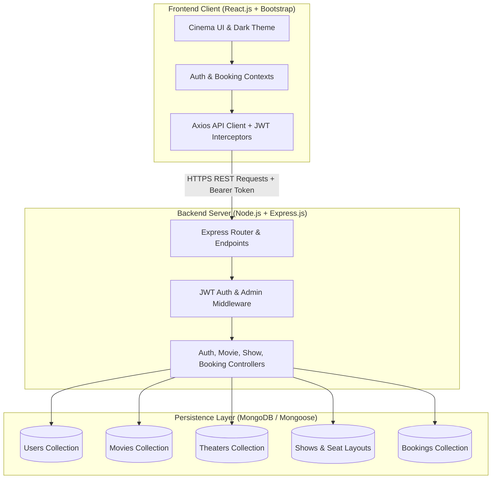
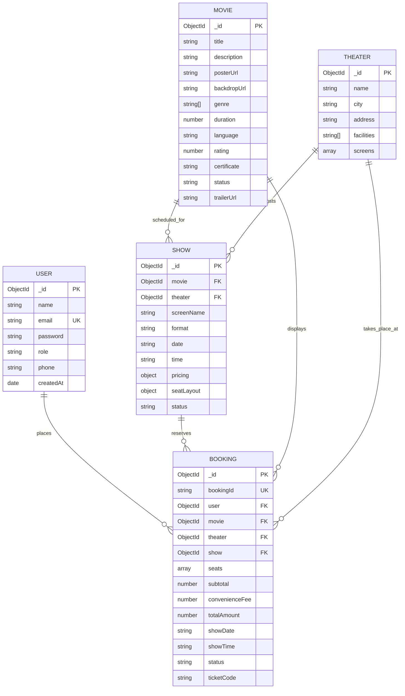
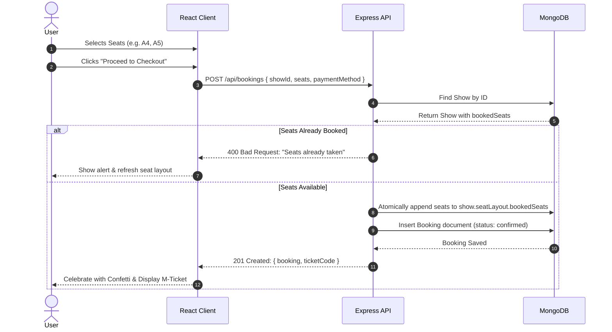

# 🏛️ IMovies - Architecture & Technical Specification

> **Project Name:** IMovies - Movie ticket booking made simple  
> **Architecture Pattern:** Client-Server, MVC (Model-View-Controller) RESTful Architecture  
> **Tech Stack:** MERN (MongoDB, Express.js, React.js, Node.js) with Bootstrap 5  

---

## 1. System Overview

IMovies is a full-stack cinema ticketing web platform engineered to deliver high-performance, real-time seat availability tracking, frictionless checkout, and digital ticket management. The application decouples presentation logic (React SPA) from business orchestration and persistence layers (Express & MongoDB) through a hardened RESTful API secured by JSON Web Tokens (JWT).

---

## 2. Core Epics & Stories Breakdown

The application fulfills the 6 core project epics:

1. **PROJECT ARCHITECTURE:** Technical documentation, component diagrams, schema modeling, and client-server contract.
2. **PROJECT SETUP AND CONFIGURATION:** Standardized project structure, dependency resolution, environment configuration, and root-level orchestration scripts.
3. **BACKEND DEVELOPMENT:** Express routing, REST endpoints, JWT authentication, and atomic seat reservation algorithms.
4. **DATABASE DEVELOPMENT:** Mongoose schemas, relational references, automated seeders with comprehensive mock data, and automatic in-memory fallback.
5. **FRONTEND DEVELOPMENT:** React components, Bootstrap responsive grid, dynamic seat selector with curved screen visualization, order summary, coupon discount calculator, and digital ticket generation.
6. **PROJECT EXECUTION:** Development build verification, production bundling, health check observability, and live testing.

---

## 3. Database Schema & Data Models

### Entity Relationship Model

---

## 4. Ticket Reservation Lifecycle & Concurrency Protection

To prevent double booking of seats when concurrent users attempt to reserve the same seat simultaneously:

1. **Selection:** User selects available seats in the interactive `SeatPicker` UI.
2. **Atomic Verification:** The server queries the latest `Show` document and validates that none of the selected seat identifiers exist in `seatLayout.bookedSeats`.
3. **Atomic Reservation:** Using MongoDB atomic operations (`$push`), the requested seats are appended to `show.seatLayout.bookedSeats`.
4. **Transaction Record:** A `Booking` record is created with unique reference `IMV-XXXXXX` and verification code `TKT-XXXX-XXXX`.
5. **Cancellation & Rollback:** If a booking is cancelled, an atomic `$pull` operation removes the reserved seats from `show.seatLayout.bookedSeats`, instantly freeing them for other moviegoers.

---

## 5. RESTful API Contract

### Authentication (`/api/auth`)
| Method | Endpoint | Access | Description |
|---|---|---|---|
| `POST` | `/api/auth/register` | Public | Register new user account |
| `POST` | `/api/auth/login` | Public | Authenticate user & issue JWT |
| `GET` | `/api/auth/profile` | Private | Retrieve current user profile |
| `PUT` | `/api/auth/profile` | Private | Update user profile details |

### Movies (`/api/movies`)
| Method | Endpoint | Access | Description |
|---|---|---|---|
| `GET` | `/api/movies` | Public | Get all movies with search, genre, language & status filters |
| `GET` | `/api/movies/featured` | Public | Get featured movies for carousel |
| `GET` | `/api/movies/filters` | Public | Get distinct genres & languages |
| `GET` | `/api/movies/:id` | Public | Get movie details by ID |
| `POST` | `/api/movies` | Admin | Create a new movie |
| `PUT` | `/api/movies/:id` | Admin | Update an existing movie |
| `DELETE` | `/api/movies/:id` | Admin | Delete movie from catalog |

### Shows & Showtimes (`/api/shows`)
| Method | Endpoint | Access | Description |
|---|---|---|---|
| `GET` | `/api/shows` | Public | Get shows with query filters |
| `GET` | `/api/shows/movie/:movieId` | Public | Get shows grouped by theater for a date |
| `GET` | `/api/shows/:id` | Public | Get show details with up-to-date seat matrix |
| `POST` | `/api/shows` | Admin | Create show schedule |

### Bookings (`/api/bookings`)
| Method | Endpoint | Access | Description |
|---|---|---|---|
| `POST` | `/api/bookings` | Private | Reserve seats and generate ticket |
| `GET` | `/api/bookings/my-bookings` | Private | Get current user's booking history |
| `GET` | `/api/bookings/:id` | Private | Get specific ticket pass by ID |
| `PUT` | `/api/bookings/:id/cancel` | Private | Cancel reservation & release seats |
| `GET` | `/api/bookings` | Admin | View all bookings across the platform |

### Admin Analytics (`/api/admin`)
| Method | Endpoint | Access | Description |
|---|---|---|---|
| `GET` | `/api/admin/stats` | Admin | Platform revenue, tickets sold, and recent bookings |
